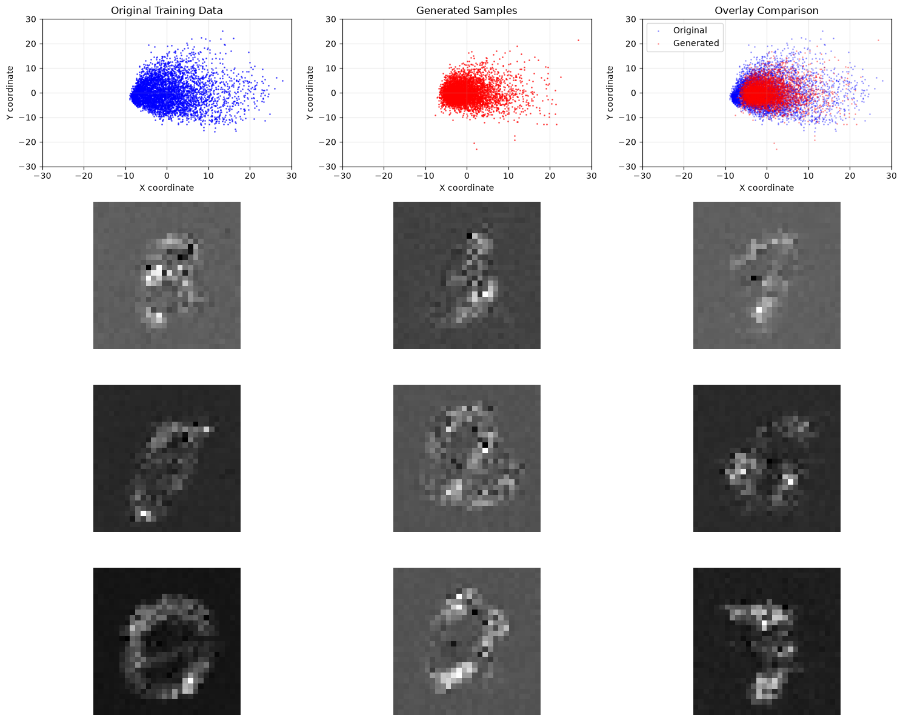
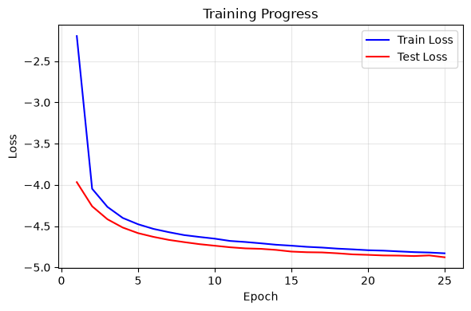
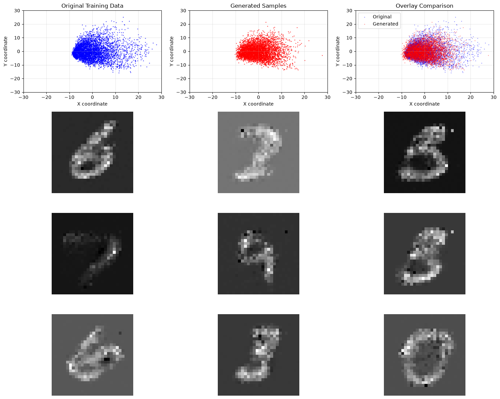
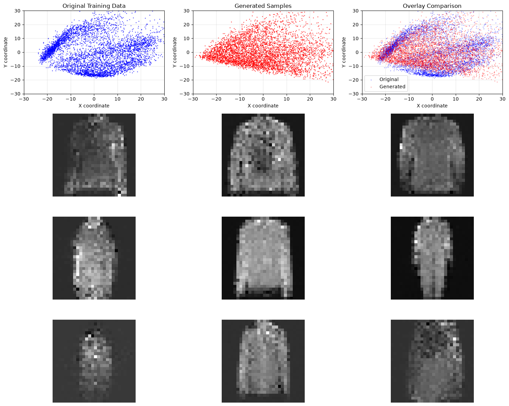
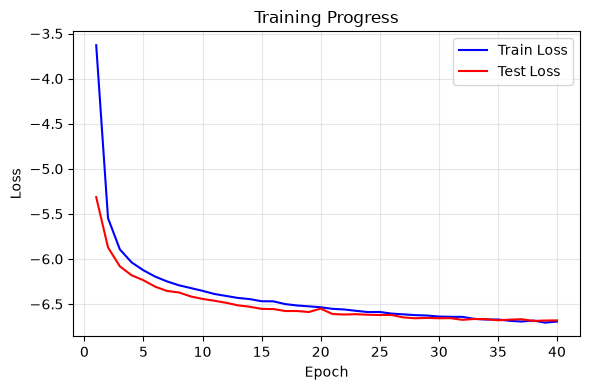

# GenAI CV Homework
- Author: Vladyslav Cherniuk

First of all, I'd like to mention that all the models I tried are intended to fit into my laptop GPU - RTX 5070 Mobile. So the hyperparameters and model architectures were picked having the 8 GB VRAM in mind.

### 1. RealNVP

I have used the RealNVP example from the lecture and adapted it for working with MNIST dataset images:
- Removed unnecessary code;
- Loaded the MNIST dataset;
- Changed the layer sizes: 784 (28*28) input and output for flattened images, and 1024 hidden, so that it is greater than the number of pixels in the image;
- Changed the mask: I made a mask that covers to transform only the top half of the image (14*28), but the mask is flattened, so it's just 784/2 first pixels;
- Changed visualizations: as generated moon dataset has only 2 dimensions, it was easier to visualize. To visualize the 784-dimensional data I used PCA, fitted on each set of observations separately, when comparing generated and original distributions. It was made this way because fitting PCA to only one distribution and transforming both resulted in one of the distributions being just a point. For input-output layers it's different because the latent space is 0-mean with std 1, so PCA for this kind of data would just show a small point cloud that is impossible to compare to the other data;
- Added CUDA tensors utilization: the example was utilizing only CPU, so the training was quite slow, I've updated the code to move the data to the GPU;
- Added visualizations of specific generated data samples;

These actions led to the following results:

Loss: -4.8782

Then I tried experimenting with the hyperparameters:
- Increasing/decreasing the hidden layer size;
- Increasing/decreasing the number of coupling layers;
- Adapting the learning rate for larger models;

I didn't succeed in making high hidden layer size and deep overall network with big amount of coupling layers simultaneously, so I tried adapting them one or another. Having more than 12 coupling layers or more than 2048 nodes in the hidden layer resulted in either quick overfitting or great numerical metrics and poor overlap with the original data. For example, this is the model  with 2084 nodes in the hidden layer and 16 coupling layers.

Loss: -8.6234

Then I tried changing the architecture: adding one hidden layer inside the coupling layers. So the best model with was the one with two hidden layers in the coupling layer with 2048 nodes each and 12 coupling layers.

Loss: -7.4559

Then I just trained the same model on MNIST Fashion dataset and got the following results.

Loss: -6.6809